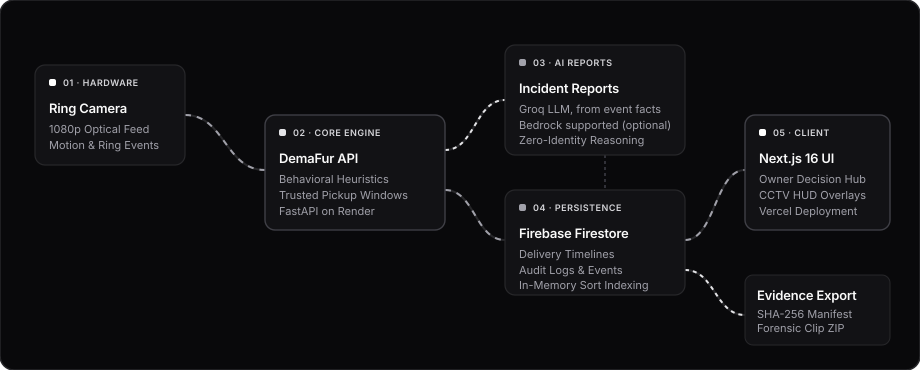
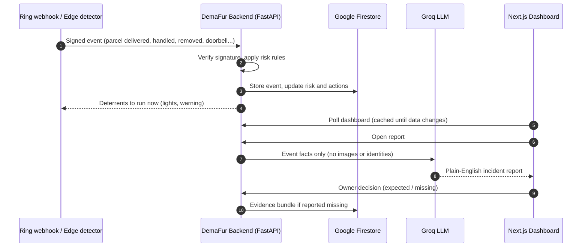

# DemaFur

### Stop parcel theft while it's happening
A Ring camera companion that watches what happens to your parcel, not who is at the door, and acts while the person is still there: porch lights, a spoken warning, an incident report and an evidence bundle.

 

 

 

[Try it](#try-it) • [Overview](#project-overview) • [Architecture](#system-architecture) • [Features](#features) • [Ring integration](#ring-integration) • [Technologies](#technologies) • [Local setup](#local-setup) • [Team](#team)

---

## Try it

No account needed.

1. Open **[dema-fur.vercel.app/dashboard](https://dema-fur.vercel.app/dashboard)** and choose **Try the demo without an account**. The backend runs on Render's free tier, so the first load can take up to a minute.
2. Press **Play demo footage**. One of three recorded scenarios plays (a theft, a hand-over to the resident, a courier drop-off), and its events reach the backend as they happen on screen. Watch the risk level and the counters change.
3. Open **View report** for the verdict, timeline, AI-written incident report and automatic responses. **Report parcel missing** prepares the evidence bundle.

> Demo footage: Getty Images previews, used for illustration only. Ring events in the demo come from the Ring sandbox described below; no physical Ring device was used.

---

## Project Overview

A doorbell camera is good at recording a parcel being taken and not much use at stopping it. By the time the owner opens the notification, the person and the parcel are gone.

**DemaFur** notices the moment that matters and acts on it:
* **Context, not identity.** Events (delivered, approached, handled, picked up, left, carried inside) are weighed against context: is a pickup scheduled, did the person come out of the house, or did they arrive from the street? No face recognition, identity or demographic inference.
* **Prevention first.** When a stranger handles the parcel with no pickup expected, porch lights and a spoken warning fire straight away. Leaving with it makes it a high-risk incident.
* **No false alarms for normal life.** A resident taking the parcel inside, or a pickup inside a window the owner scheduled, raises nothing.
* **Explainable.** Every risk level comes with plain-language reasons; scores are heuristics, not probabilities, and the owner makes the final call.
* **Evidence when it's needed.** A ZIP with the timeline, a police report draft, a neighbourhood notice and a SHA-256 checksum manifest of every file.

---

## System Architecture

### 1. Data Pipeline Architecture

  <picture>
    <source media="(prefers-color-scheme: dark)" srcset="docs/architecture-dark.svg">
    <source media="(prefers-color-scheme: light)" srcset="docs/architecture-light.svg">
    
  </picture>

 

---

### 2. Event Sequence

---

## Features

| Feature | Description |
| :--- | :--- |
| **Demo footage** | Three recorded scenarios (theft, hand-over to the resident, courier drop-off) replayed through the real pipeline, with events timed to the footage. |
| **Explainable risk** | `normal`, `needs_confirmation`, `suspicious` and `high_risk`, each with plain-language reasons. |
| **Automatic deterrents** | Porch lights and a spoken warning fire as soon as the risk turns suspicious (simulated hardware; see the edge detector). |
| **Trusted pickup windows** | Schedule a window in which removals count as a normal pickup. |
| **Incident report** | Plain-English summary written by a Groq-hosted LLM from event facts, cached until the delivery changes, with a rule-based fallback. |
| **Evidence bundle** | `demafur-evidence.zip` with the timeline, report drafts, `sha256-manifest.json` and any downloaded Ring clips. |
| **Edge detector** | `edge/`: YOLOE + ByteTrack track people and the parcel on a live camera or video, send signed events and run the deterrents. |
| **Accounts** | Firebase Authentication with Google or email, including password reset. |

---

## Ring integration

* **Account linking:** Ring-driven linking with nonce verification, OAuth token exchange and refresh, and household check via `/v1/users/me`.
* **Webhooks:** `POST /v1/webhooks/ring` verifies the HMAC `X-Signature`, the v1.1 envelope and the household, rejects stale events, deduplicates them and routes each device to the parcel it is watching.
* **Recordings:** a worker downloads event clips and samples frames for optional vision analysis.
* **Ring sandbox:** the Ring Developer Playground does not deliver webhooks and our team has no Ring device, so `RING_SANDBOX=true` adds a synthetic doorbell whose events are signed with the app's real HMAC key and sent through the same handler. `backend/ring_simulator.py` posts signed events to the public webhook URL exactly as Ring would. See [backend/README.md](backend/README.md#ring-sandbox-demo-without-a-ring-camera).

What we ran into along the way is in the [friction log](docs/FRICTION_LOG.md).

---

## Technologies

* **Frontend**:    
* **Backend**:   
* **Database & Auth**:  
* **AI**:  for incident reports;  and OpenCV in the edge detector. Amazon Bedrock is supported by the backend (`AI_PROVIDER=bedrock`) but not used in the live demo.
* **Ring**: 
* **Hosting & Monitoring**:   

---

## Local setup

| Part | Folder | Guide |
| :--- | :--- | :--- |
| Backend API (FastAPI, Firestore or in-memory) | `backend/` | [backend/README.md](backend/README.md) |
| Dashboard (Next.js) | `frontend/` | `npm install`, then `npm run dev`; set `NEXT_PUBLIC_API_URL` and `NEXT_PUBLIC_DEMAFUR_API_KEY` in `frontend/.env.local` |
| Edge detector (camera AI) | `edge/` | [edge/README.md](edge/README.md) |

Quick local run without Firebase: start the backend with `DEMAFUR_LOCAL_DB=memory` (data stays in memory), then the dashboard.

Uptime: the backend's `GET /health` is monitored every 5 minutes on the [status page](https://stats.uptimerobot.com/5q6oQH46Zd), which also keeps the free Render instance warm.

---

## Team

* **Chaitanya Changala** — [@CChangala](https://github.com/CChangala)
* **Qinyi Lam** — [@griffburntwood](https://github.com/griffburntwood)
* **Reyan Arshad** — [@reyan36](https://github.com/reyan36)

---

## License

Distributed under the **MIT License**. See [`LICENSE`](LICENSE) for more information.

   
  <b>Built for the Amazon Developer Hackathon 2026</b>

