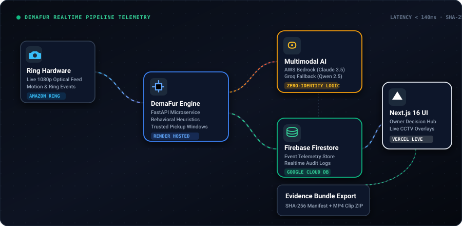
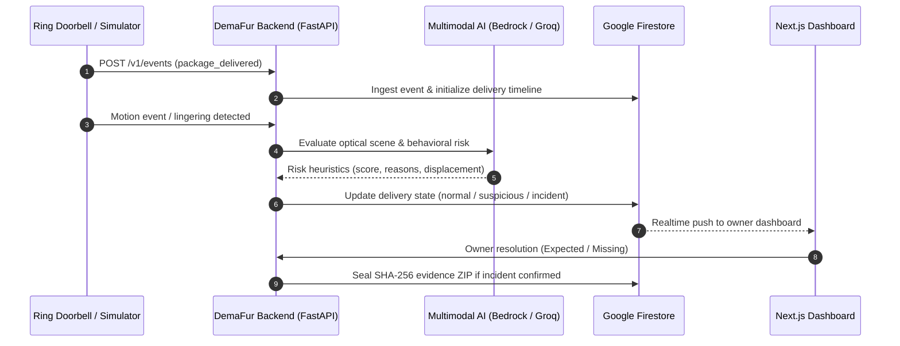

<div align="center">

# DemaFur

### AI-Supervised Delivery Safety & Doorstep Theft Defense
An intelligent Ring camera companion that analyzes behavioral risk, defends packages against porch pirates, and generates cryptographically sealed incident evidence bundles.

<br/>

[](https://demafur.vercel.app)
[](https://demafur.onrender.com)
[](https://stats.uptimerobot.com/5q6oQH46Zd)
[](https://aws.amazon.com/)

<br/>

[](https://github.com/reyan36/DemaFur)
[](https://www.python.org/)
[](https://fastapi.tiangolo.com/)
[](https://nextjs.org/)
[](https://firebase.google.com/)
[](LICENSE)

<br/>

[Overview](#project-overview) • [System Architecture](#system-architecture) • [Features](#features) • [Technologies](#technologies) • [Live Status & Uptime](#live-status--uptime) • [Local Setup](#local-development) • [Developer](#developer)

</div>

---

## Project Overview

Over **260 million delivered packages** are stolen from doorsteps across North America every year. Most security systems simply dump raw, continuous footage onto homeowners, leaving them to manually scrub through hours of false alarms or discovery after the package is already gone.

**DemaFur** changes this paradigm:
* **Zero-Identity Behavioral Analysis**: Instead of intrusive, bias-prone facial harvesting or identity profiling, DemaFur operates on pure **behavioral physics** — observing linger durations, approach trajectory, displacement velocity, and departures.
* **Trusted Pickup Windows**: Authorize household members, couriers, or trusted neighbors with temporary time windows that automatically suppress alarms.
* **Forensic Evidence Bundle**: If theft occurs, DemaFur automatically compiles a sealed SHA-256 manifest containing police-ready report drafts, neighborhood notices, and footage clips.
* **Privacy-First**: *"Behavior over identity. Owner confirmation over assumptions."*

---

## System Architecture

The animated telemetry pipeline below illustrates how video and motion events stream from the doorstep camera into the behavioral engine, multimodal AI, realtime database, and dashboard:

<div align="center">
  
</div>



---

## Features

| Feature | Description |
| :--- | :--- |
| **Simulate a Camera** | Trigger 4 realistic doorstep scenarios: *Porch Pirate Theft*, *Suspicious Lingering*, *Safe Courier Drop-Off*, and *Authorized Pickup*. |
| **Optical Risk Heuristics** | Real-time classification into `normal`, `needs_confirmation`, `suspicious`, and `high_risk` based on dwell time and box displacement. |
| **Trusted Pickup Windows** | Create pre-authorized 30-minute retrieval windows that automatically verify parcel collection and suppress alerts. |
| **Forensic Evidence Packager** | One-click download of `demafur-evidence.zip` containing an immutable `sha256-manifest.json`, police report draft, and MP4 video clips. |
| **Dual AI Engine** | Primary reasoning on **AWS Bedrock** (Claude 3.5) with automatic failover to **Groq AI** (Qwen 2.5 Vision) for uninterrupted uptime. |
| **Google Authentication** | Secure household login backed by **Google Firebase Auth** protecting the surveillance portal from unauthorized access. |
| **One-Click False Alarm Dismissal** | Individual delete buttons on each delivery to dismiss false positives or clear test records instantly. |

---

## Technologies

The application is built using a modern, scalable, and high-performance stack:

* **Frontend**: [](https://nextjs.org/) [](https://react.dev/) [](https://tailwindcss.com/) [](https://www.typescriptlang.org/)
* **Backend**: [](https://fastapi.tiangolo.com/) [](https://www.python.org/) [](https://docs.pydantic.dev/)
* **Database & Auth**: [](https://firebase.google.com/) [](https://firebase.google.com/docs/auth)
* **AI Engine**: [](https://aws.amazon.com/bedrock/) [](https://groq.com/)
* **IoT Hardware**: [](https://developer.ring.com/)
* **DevOps & Monitoring**: [](https://vercel.com/) [](https://render.com/) [](https://stats.uptimerobot.com/5q6oQH46Zd)

---

## Live Status & Uptime

The production backend and database health are monitored 24/7 with automated 5-minute heartbeat telemetry to ensure zero cold-boot delays:

* **Live Status Dashboard**: [stats.uptimerobot.com/5q6oQH46Zd](https://stats.uptimerobot.com/5q6oQH46Zd)
* **Health API Endpoint**: `GET https://demafur.onrender.com/health`
* **Readiness Endpoint**: `GET https://demafur.onrender.com/ready`

---

## Local Development

### 1. Prerequisites
* **Node.js** v20+ & `npm`
* **Python** 3.11+ (optional, Render backend is accessible remotely)

### 2. Frontend Setup
```bash
# Clone the repository
git clone https://github.com/reyan36/DemaFur.git
cd DemaFur/frontend

# Install dependencies
npm install

# Start development server
npm run dev
```

Visit [http://localhost:3000](http://localhost:3000) to open the dashboard.

### 3. Backend Setup (Optional)
```bash
cd backend
python -m venv .venv
source .venv/bin/activate  # On Windows: .venv\Scripts\activate
pip install -r requirements.txt

# Run FastAPI backend
uvicorn demafur.app:create_app --factory --host 127.0.0.1 --port 8000
```

---

## Developer

* **Chaitanya Changala** — [@CChangala](https://github.com/CChangala)
* **Qinyi Lam** — [@griffburntwood](https://github.com/griffburntwood)
* **Reyan Arshad** — [@reyan36](https://github.com/reyan36)

---

## License

Distributed under the **MIT License**. See [`LICENSE`](LICENSE) for more information.

<div align="center">
  <br/>
  <b>Built with ❤️ for the Amazon Developer Hackathon 2026</b>
</div>
